 

> **By day** I keep racks humming as a Data Center Technician at Amazon.
> **By night** I'm a security nerd with a cyber degree who tinkers with Linux, Python, and whatever random project I can talk Claude Code into building with me.
>
> I took a little break from the keyboard. Dusting off the save file now. 🕹️

| | Quest | Status |
|:-:|---|:-:|
| 🎲 | **D&D Tracker** · campaign companion app, being rebuilt from the ground up | `⚒️ FORGING` |
| 🔬 | **[rea-schwiftyfork](https://github.com/nisakson2000/rea-schwiftyfork)** · reverse-engineer anything with agents, from app behavior to native binaries | `🧭 EXPLORING` |
| 🛡️ | **[Detection-Hunting-Queries](https://github.com/nisakson2000/Detection-Hunting-Queries)** · KQL threat-hunting & detection queries for Sentinel / Defender XDR | `🔁 REPEATABLE` |
| 🎬 | **[yt-downloader](https://github.com/nisakson2000/yt-downloader)** · local Flask + yt-dlp app for MP4 / MP3 downloads with live progress | `✅ CLEARED` |
| 🎵 | **[Pythic-v2](https://github.com/nisakson2000/Pythic-v2)** · self-hosted Discord music bot | `✅ CLEARED` |
| 🥗 | **[meal-prep-calculator](https://github.com/nisakson2000/meal-prep-calculator)** · 154 macro-friendly recipes → scaled shopping list | `✅ CLEARED` |

 

  

 

 

